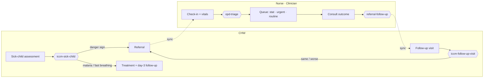

# Workflow Examples

A community-to-facility referral loop built on [`fhir-workflow`](https://github.com/ohs-foundation/kotlin-fhir-workflow). A community health worker (CHW) assesses a sick child with WHO/UNICEF iCCM and refers them. At the facility, a nurse checks the child in, triage queues them, and a clinician closes the referral. The CHW then gets a follow-up visit carrying the facility's outcome.

Every clinical decision is a FHIRPath `PlanDefinition` run by `FhirOperator.generateCarePlan`. The referral moves through the CPG `ActivityFlow`: proposal → order → perform.



## Roles

The role comes from `PractitionerRole.code` (system `http://ohs.dev/fhir/CodeSystem/app-role`), read from the gateway's `GET /api/practitioner-details`.

| Role | Sees | Does |
|---|---|---|
| `chw` | Patients, Follow-ups, Referrals | Registers and assesses children. A danger sign sends the referral on submit. |
| `nurse` | Patients | Checks patients in with vitals, which runs triage. |
| `clinician` | OPD queue | Works the queue most urgent first and records each outcome. |

A user without a known role gets a "No role assigned" screen and never syncs. Users can share a device; a new sign-in starts a fresh download.

## Protocols

The protocols live in [`files/protocols/`](./src/commonMain/composeResources/files/protocols) and stay in memory. They're never written to the local database, because the gateway refuses `PlanDefinition` uploads.

| PlanDefinition | Input | Produces |
|---|---|---|
| `iccm-sick-child` | `%assessment` | An urgent referral on any danger sign. Otherwise medicine for malaria or fast breathing, plus a day-3 follow-up. |
| `opd-triage` | `%vitals`, `%referrals` | A consult task: `stat` if SpO₂ < 90 or the referral is urgent, `urgent` for other referrals, else `routine`. |
| `referral-follow-up` | `%referral` | A follow-up for the referring CHW, due in two days, carrying the outcome. |
| `iccm-follow-up-visit` | `%visit` | A new urgent referral if the child is the same, worse or has a danger sign. |

There's no CQL in the library, so conditions are FHIRPath over data the app passes in. To change clinical logic, edit the JSON. `IccmSickChildTest` and `OpdTriageTest` pin every branch.

## Sync

Each role downloads what [`files/sync/<role>.json`](./src/commonMain/composeResources/files/sync) lists: a resource `type`, search `params` and `ids`. The placeholders `{practitioner}`, `{organization}` and `{location}` come from the user's PractitionerRole.

```json
{ "type": "ServiceRequest", "params": { "intent": "order", "performer": "Organization/{organization}" } }
```

The gateway's org-scoped access checker adds the organization filter to every search, so the configs only narrow by role. `SyncConfigFilesTest` fails on any type or param the gateway refuses.

Saving a form or completing a consult uploads straight away. Offline, the upload waits for the next sync. The OPD queue refreshes every minute and on pull.

## Setup

1. **JDK 21.** Gradle rejects JDK 25.
2. **`local.properties`**: copy `local.properties.sample` and set `OAUTH_ISSUER`, `OAUTH_CLIENT_ID` and `FHIR_BASE_URL`.
3. **Gateway**: it must accept `PATCH`, because the engine sends every update that way.
4. **Demo users**: create the seed service account, fill in `scripts/seed.env` from `scripts/seed.env.sample`, and run `./scripts/seed.sh`.

### Seed service account

`seed.sh` signs in as a Keycloak service account in the app's realm (`ohs-player`).

1. Create an OpenID Connect client, for example `seed-service`.
2. Turn on *Client authentication* and *Service accounts roles*. Leave the other flows off.
3. Copy the client secret from *Credentials*.
4. Under *Service accounts roles*, add `realm-management` → `manage-users` and `manage-realm`.
5. Put `SEED_CLIENT_ID` and `SEED_CLIENT_SECRET` in `scripts/seed.env`. It's git-ignored.

Each run also grants the account `ORG_SCOPE_EXEMPT` and the `GET_*`/`PUT_*` roles the gateway needs for organization and location writes.

### Demo data

The seed creates only what three users need to sign in and sync, and no patients. Ids are fixed UUIDs in [`scripts/seed-bundle.json`](./scripts/seed-bundle.json), so re-running updates rather than duplicates.

```
Kiambu County Department of Health          county code 022
└─ Ruiru Sub-County Health Management Team
   └─ Kimbo Health Centre                    KE-022-0417     Outpatient Department
      └─ Kimbo Community Health Unit         KE-022-0417-01  Kimbo Village
```

| User | Password | Name | Role | Organization |
|---|---|---|---|---|
| `chw1` | `chw_1234!` | Mwanaisha Juma Mwinyi | `chw` | Kimbo Community Health Unit |
| `nurse1` | `nurse_1234!` | Kadzo Zawadi Baya | `nurse` | Kimbo Health Centre |
| `clinician1` | `clinician_1234!` | Hamisi Kazungu Charo | `clinician` | Kimbo Health Centre |

CHW referrals go to Kimbo Health Centre, the unit's `partOf`. Names and codes are realistic but fictional. The server is public, so these passwords are for demos only.

## Run

From this directory:

| Target | Command |
|---|---|
| Desktop | `./gradlew run` |
| Android | `./gradlew assembleDebug` |
| Web (Wasm) | `./gradlew wasmJsBrowserDevelopmentRun` |
| iOS | Open `iosApp/` in Xcode |

## Walkthrough

1. **chw1**: register a 14-month-old, open her, and run *Sick-child assessment* with *Chest indrawing* = yes. The form closes with *Referral sent to the facility*.
2. **nurse1**: tap *Sync now*, open the child and *Check in to OPD* with SpO₂ 95. She's queued **stat** because the referral is urgent.
3. **clinician1**: the child appears at the top of the queue, marked *Community referral*. Open her, enter an outcome and **Complete**.
4. **chw1**: tap *Sync now*. Her row shows **Follow-up due**, two days out, with the facility's outcome.
5. Record the visit under *Follow-ups*. **Better** closes the loop. **The same**, **worse** or a danger sign refers her again.

The list chip tracks each child: **Referred** → **Seen at facility** → **Follow-up due** → none. A walk-in skips step 1: the nurse registers and checks them in, and triage queues them `routine`, or `stat` below SpO₂ 90.

## Tests

```shell
./gradlew jvmTest
```

| Area | Tests |
|---|---|
| Protocol branches | `IccmSickChildTest`, `OpdTriageTest` |
| Referral loop on a real engine | `ProtocolServiceTest`, `AtomicSubmitTest` |
| Sync | `SerializedSyncManagerTest`, `SyncTest`, `SyncConfigFilesTest`, `RoleDownloadWorkManagerTest` |
| Roles | `UserContextTest`, `PractitionerDetailsApiTest` |
| Screens | `QueueContentTest`, `HomeScreenTest` |

## Not covered

Households, pre-referral treatment, ANC, immunisation, stock, CQL, indicators, lab and pharmacy roles, and per-user data isolation on a shared device.
